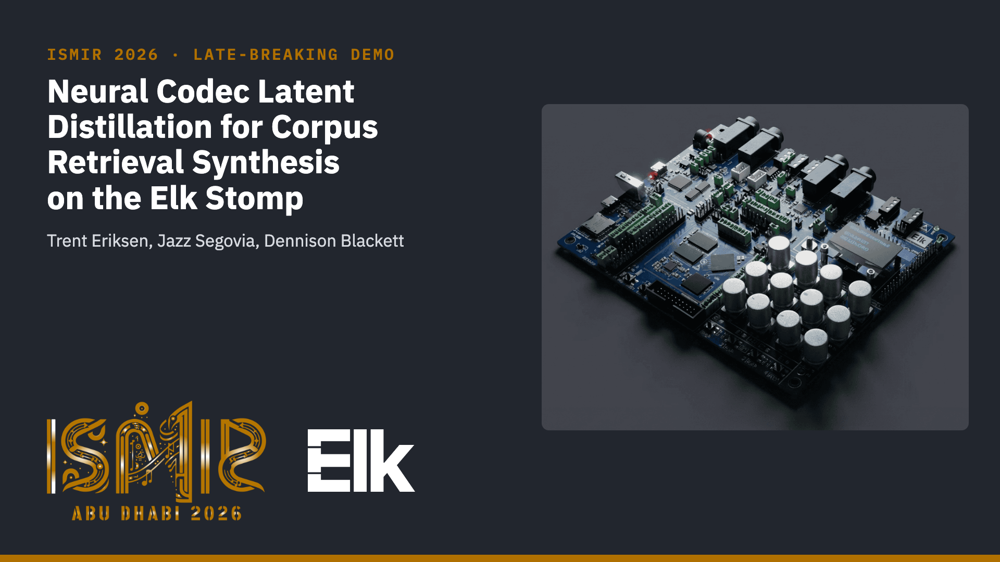
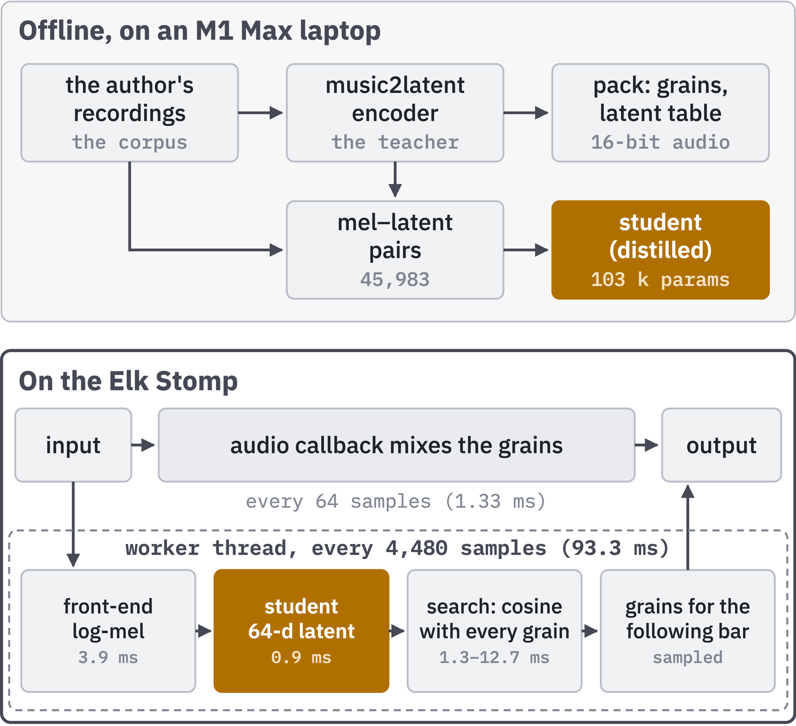
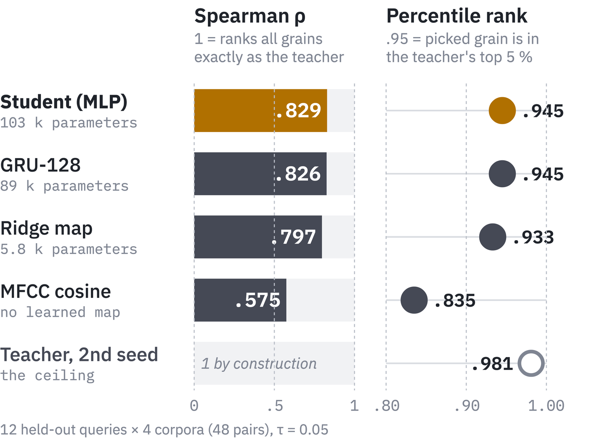
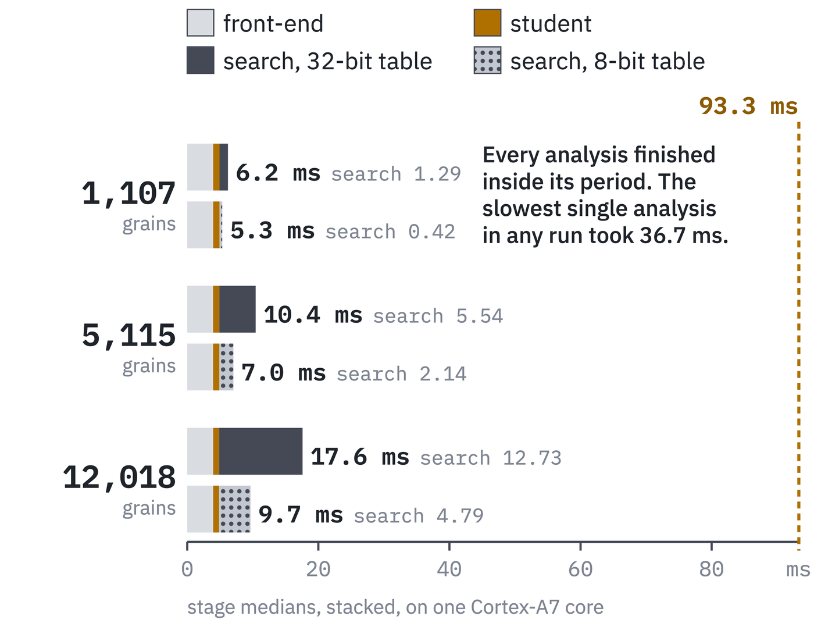
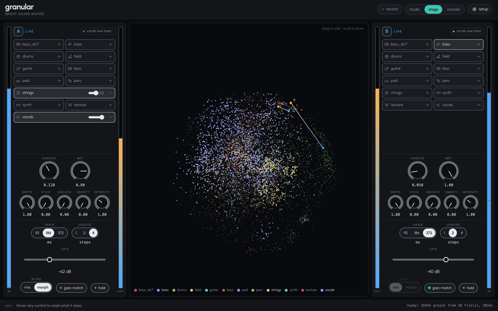
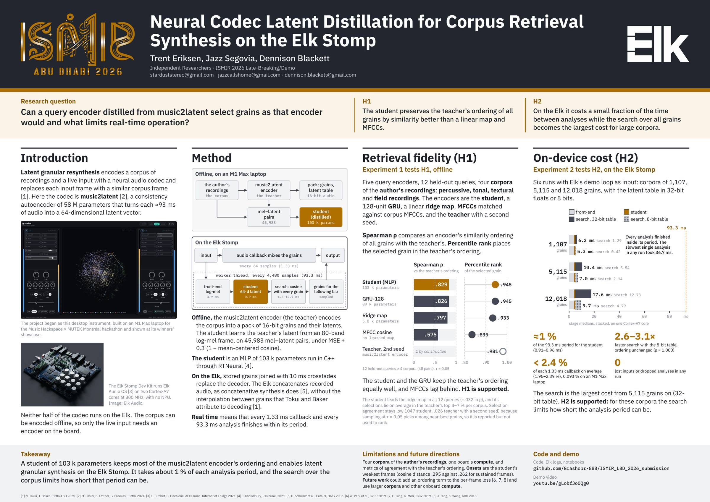

# Neural Codec Latent Distillation for Corpus Retrieval Synthesis on the Elk Stomp

**Trent Eriksen, Jazz Segovia, Dennison Blackett** · Independent Researchers<br>
Late-Breaking/Demo session, ISMIR 2026, Abu Dhabi · paper 679

[](paper/Neural_Codec_Latent_Distillation_for_Corpus_Retrieval_Synthesis_on_the_Elk_Stomp.pdf)
[](https://youtu.be/P9qW92YsQns)
[](docs/poster/679_poster.pdf)
[](LICENSE)
[](weights/README.md)

<p align="center">
  <a href="https://youtu.be/P9qW92YsQns"></a>
  <br><sub><a href="https://youtu.be/P9qW92YsQns">Watch the video walkthrough of the paper (4:37)</a></sub>
</p>

## Abstract

Latent granular resynthesis encodes a corpus and an input with a neural audio codec and replaces each input frame with
a similar corpus frame. The Elk Stomp Dev Kit, a device without a neural processing unit, cannot run codecs like
music2latent that are often utilized for this type of synthesis. We ask whether a small query encoder, distilled from
music2latent selects grains as that encoder would, and what limits real-time operation. A distilled multilayer
perceptron of 103k parameters is compared offline on input with four other query encoders with each analysis stage
timed on the Elk. Results indicate it preserves the encoder's similarity ordering better than a linear map and MFCCs
(Spearman ρ .83 against .80 and .58), with selections on average in the encoder's top 4–7 %. On the Elk it takes about
1 % of the 93 ms analysis period, and only the search grows with corpus size.

## The system

<p align="center"></p>

Offline, a student network is distilled from the music2latent encoder, which encodes the corpus. On the Elk Stomp the
student replaces the encoder for the live input, and stored 16-bit grains joined with 10 ms crossfades replace the
decoder. The student is a multilayer perceptron of 103 k parameters, run in C++ through RTNeural.

## Results

| Retrieval fidelity (H1), offline | On-device cost (H2), on the Elk Stomp |
|---|---|
|  |  |
| **Spearman ρ**: how closely an encoder ranks all grains in the teacher's order (1 = the same order). **Percentile rank**: where the grain it picks sits in the teacher's ranking (.95 = the teacher's top 5 %). 12 held-out queries on four corpora (percussive, tonal, textural, field recordings), 48 pairs. | Median time per analysis. The student takes about 1 % of the 93.3 ms period. The search grows with the corpus and is the largest cost from 5,115 grains on. An 8-bit latent table makes it 2.6 to 3.1 times faster with the same ordering. No run lost input. |

## Where it started

<p align="center"></p>

The study began as a desktop instrument for latent granular resynthesis, built on an M1 Max laptop for the
[Music Hackspace × MUTEK Montréal hackathon](https://forum.mutek.org/en/shows/2026/music-hackspace-x-mutek-hackathon-winners-showcase) (22–23 Aug 2026) and shown at its winners' showcase.
Its original demo video: https://youtu.be/gLobf3o0Qg0

## Poster

<p align="center"><a href="docs/poster/679_poster.pdf"></a></p>

## Paper and supplementary material

- **Paper**, camera-ready (paper 679, 16 Oct 2026, CC BY 4.0): [`paper/Neural_Codec_Latent_Distillation_for_Corpus_Retrieval_Synthesis_on_the_Elk_Stomp.pdf`](paper/Neural_Codec_Latent_Distillation_for_Corpus_Retrieval_Synthesis_on_the_Elk_Stomp.pdf)
- **Video walkthrough** of the paper (camera-ready video, 4:37): https://youtu.be/P9qW92YsQns
- **Poster** (A0 landscape): [`docs/poster/679_poster.pdf`](docs/poster/679_poster.pdf)
- **Original demo video** of the desktop instrument (the paper's footnote 3): https://youtu.be/gLobf3o0Qg0
- **Music Hackspace × MUTEK Montréal hackathon, winners' showcase**, where the desktop instrument was presented (the
  paper's footnote 1): https://forum.mutek.org/en/shows/2026/music-hackspace-x-mutek-hackathon-winners-showcase

## About this repository

This repository lets you read the code behind each result, run notebooks that show each step and reproduce the
paper's numbers from the data that can be shared, and rebuild the board plugin.

## Contents

| Path | What |
|---|---|
| `paper/` | the camera-ready paper (PDF, CC BY 4.0) |
| `latent/granular.py` | the desktop instrument's core: music2latent encoding, grains, the matching table, selection by a softmax over mean-centred cosine similarities with temperature τ (with anti-repetition and continuity penalties), decoding |
| `corpus_builder/` | the offline pack builder (`build_corpus.py`), the `.elkgrain` format (`elkgrain.py`, specified in `docs/pack-format.md`), selection over a pack (`match.py`, identical selections to `granular.substitute`), tests |
| `distillation/` | Experiment 1: corpora, queries, mel–latent pairs, the student (MLP, GRU), the ridge maps, the metrics, the 8-bit table study (see its README) |
| `plugin/` | the instrument as a VST3 plugin for SUSHI (JUCE 8, RTNeural): audio callback, worker thread, front-end, student, search, grain scheduling, parity and benchmark tools |
| `board/` | cross-build image and toolchain, deployment over the serial console, the run script and SUSHI configurations for the Elk Stomp |
| `weights/` | the paper's trained student MLP (the network the board runs), the GRU and the pooled ridge map (CC BY-NC 4.0) |
| `results/` | numbers only: Experiment 1's per-query metrics, the board transcripts of Experiment 2 |
| `analysis/` | transcript parser, Table 1 builder, the generated demo signal, notebook helpers |
| `notebooks/` | five notebooks, committed with their outputs, each ending with a table of the paper's numbers it reproduces |
| `figures/` | Figure 1 (TikZ) and Figure 2 (matplotlib, drawn from the transcripts) |
| `docs/` | the pack format (`pack-format.md`), the poster (`poster/679_poster.pdf`) and the images on this page (`images/`) |

## Quick start

Needs [uv](https://docs.astral.sh/uv/) and Python 3.12 (uv installs it). The first run downloads music2latent's
weights (CC BY-NC 4.0) from Hugging Face.

```bash
uv sync                                                                        # the environment, pinned by uv.lock
uv run jupyter lab notebooks/                                                  # read and run the notebooks
uv run jupyter nbconvert --to notebook --execute --inplace notebooks/*.ipynb    # re-execute them all (about 3 min on a laptop CPU)
uv run pytest                                                                  # pack format and selection-parity tests
```

The notebooks run on a generated demo signal (`analysis/demo.py`) and on `results/`. Nothing they write
(`$LBD_WORK`, default `work/`) is part of the repository.

| Notebook | Shows | Reproduces |
|---|---|---|
| `01_corpus_packing` | encoding a corpus offline, grains, the matching table, writing and reading a pack, selection over the pack equal to the desktop instrument's | music2latent's 58 M parameters, 64-d latents per ≈93 ms frame, 16-bit pack audio, table sizes |
| `02_student_distillation` | mel–latent pairs, training the MLP under the paper's loss, parameters and multiply–accumulates (MACs) per frame, RTNeural export checked against PyTorch, the paper's students round-tripping exactly | the student's 102,976 parameters (103k, 0.10 M) and the GRU's 88,896 (0.09 M), 45,983 training pairs |
| `03_retrieval_fidelity` | the four metrics on the demo pack, why the teacher agrees with itself on few selections at τ = 0.05 (Σ p²), Table 1 from `results/exp1` | Table 1 over all 48 query–corpus pairs, the abstract's ρ .83/.80/.58 and "top 4–7 %", the student's .032 lead over the ridge map in every query, onset error .295 against .262 |
| `04_int8_table` | quantising the latent table to 8 bits, orderings before and after | ρ = 1.000 between the student's 32- and 8-bit orderings |
| `05_board_measurements` | parsing the board transcripts, every run, stage medians, callback shares, microbenchmarks, Figure 2 | every on-board number in Results and Figure 2 |

## Paper to code

Every number the paper prints, where it comes from, and where it is reproduced. "Data" names the shipped file the
number is computed from.

| Paper | Value | Code | Data | Reproduced in |
|---|---|---|---|---|
| Abstract, Table 1, Discussion: student size | 103k, 0.10 M parameters (102,976) | `distillation/student.py` (`MLP`, `export_mlp_json`) | `weights/student_mlp_mel80.json` | 02 |
| Abstract, Table 1, Results: ρ student / ridge map / MFCC | .83 / .80 / .58 (.829 / .797 / .575) | `distillation/evaluate.py` (`spearman_rows`), `analysis/exp1.py` | `results/exp1/metrics_per_query.csv` | 03 |
| Abstract: student's selections in the top 4–7 % of the teacher's ordering | 4–7 % | `distillation/supplement.py` (`live_pctile`) | same | 03 |
| Abstract, Results: student about 1 % of the analysis period | 0.97–1.03 % | `plugin/src/WorkerCore.cpp` (STAGES timers), `analysis/board_logs.py` | `results/board/raw/R1*.txt` | 05 |
| Abstract, Figure 2: only the search grows with the corpus | front-end 3.93–3.98 ms, student 0.91–0.96 ms, search 1.29 to 12.73 ms | same | same | 05 |
| Introduction, Discussion: music2latent parameters | 58 M | `music2latent` (counted) | — | 01 |
| Introduction: one latent per ≈93 ms of audio | 64-d latents, ≈93 ms | `latent/granular.py` (`Codec`) | — | 01 |
| Section 3: stored grains joined with 10 ms crossfades | 10 ms (480 samples at 48 kHz) | `corpus_builder/build_corpus.py` (`margin_ms`), `plugin/src/WorkerCore.cpp` (grain scheduling) | `results/board/raw/R1*.txt` (the plugin's pack line, `margin48=480`) | — |
| Section 3: a pack holds 16-bit audio and teacher latents | 16-bit | `corpus_builder/build_corpus.py`, `elkgrain.py` | — | 01 |
| Section 3: 80-band log-mel from one 4096-point FFT | 80, 4096 | `distillation/features.py`, `plugin/src/MelFrontend.cpp` | — | 02 |
| Section 3: two hidden layers of 256 units | 256 | `distillation/student.py` | `weights/student_mlp_mel80.json` | 02 |
| Section 3: 45,983 pairs from the author's recordings and MUSDB18 previews | 45,983 | `distillation/data_prep.py` (`train`) | `results/exp1/training_pairs.json` | 02 |
| Section 3: loss | MSE + 0.3 (1 − mean-centred cosine) | `distillation/student.py` (`composite_loss`) | — | 02 |
| Section 3: audio callback every 64 samples at 48 kHz | 1.33 ms | SUSHI `--timing-statistics` ("100 % = 1333.33 µs") | `results/board/raw/R1*.txt` | 05 |
| Section 3, Figure 2: analysis every 4,480 samples | 93.3 ms | `plugin/src/WorkerCore.cpp` | `results/board/raw/R1*.txt` (worker header) | 05 |
| Section 4: 12 queries held out at file level, 4 corpora, same τ, seed and selection code | 12, 4, τ = 0.05 | `distillation/config.py` (assertions), `corpus_builder/match.py` | `results/exp1/corpora.json` | 03 |
| Section 4, Figure 2: three corpus sizes on the Elk Stomp | 1,107, 5,115, 12,018 grains | `corpus_builder/build_corpus.py` | `results/board/raw/R1*.txt` | 05 |
| Table 1: parameters of the ridge map, the GRU and the student | 5.7 k (see below), 0.09 M, 0.10 M | `distillation/ridgefit.py` (89 × 64 + 64), `student.py` | `weights/` | 02, 03 |
| Table 1: ρ, Pct., Agr., Hub of the five encoders, over all 48 query–corpus pairs | see Table 1 | `evaluate.py`, `supplement.py`, `export_results.py`, `analysis/exp1.py` | `results/exp1/metrics_per_query.csv` | 03 |
| Results: student and GRU ρ | .829 and .826 | same | same | 03 |
| Results: the student leads the ridge map by .032, in every query | +.032, 12 of 12 queries (45 of 48 query–corpus pairs) | `analysis/exp1.py` (`per_query_lead`) | same | 03 |
| Results: student's percentile rank against the teacher's | .945 against .981 | `analysis/exp1.py` | same | 03 |
| Results: every analysis finished within its period and no run lost input | all loss counters 0 | `plugin/src/WorkerCore.cpp` (SUMMARY) | `results/board/raw/R1*.txt` | 05 |
| Results: callback share, average and largest | 1.95–2.39 %, at most 10.9 % | SUSHI `--timing-statistics` | same | 05 |
| Results: the same plugin on an M1 Max laptop | 0.093 % | SUSHI `--timing-statistics` | not shipped (the file was not archived, the value is from the author's notes) | — |
| Results: the search the largest cost from 5,115 grains on (32-bit table) | stage medians | `plugin/src/Matcher.cpp` | `results/board/raw/R1*.txt` | 05 |
| Results: ρ between the student's 32- and 8-bit orderings | 1.000 | `distillation/int8_table.py` | `results/exp1/int8_vs_f32.json` | 04 |
| Figure 2: stage medians, 8-bit search 2.6 to 3.1 times faster | 2.59–3.08 (4.79 ms at 12,018 grains) | `figures/fig_budget.py`, `plugin/src/Matcher.cpp` (`ELKGRANULAR_TABLE=int8`) | `results/board/raw/R1*.txt` | 05 |
| Discussion: onset frames the student's weakest | cosine distance .295 against .262 | `distillation/evaluate.py` (embedding error) | `results/exp1/embedding_error.csv` | 03 |
| Figure 1 | — | `figures/fig_system.tex` | — | — |

Checks behind the text that the paper does not print: C++ and Python select identical grains (200 of 200) and agree on
the student, ridge map, filterbank, front-end and resampler (`plugin/tools/golden_parity.py`), the C++ 8-bit table is
byte-identical to the NumPy one (`plugin/tools/int8_parity.py`), and pack selection equals the desktop instrument's
(`corpus_builder/tests/test_parity.py`).

### Where the logs and the printed paper differ

One entry. Table 1's Parameters column prints 5.7 k for the ridge map, which is its multiply–accumulate count per
frame (89 × 64 = 5,696). With its 64 biases the ridge map has 5,760 parameters (5.8 k). Notebook 03 prints both
counts. Every other number above equals the paper at its printed precision.

## Rebuilding the plugin

```bash
cmake -S plugin -B plugin/build -DCMAKE_BUILD_TYPE=Release && cmake --build plugin/build -j 8   # desktop: VST3, ElkgrainGolden, elkgrain_bench
board/crossbuild/build.sh                                                                       # Elk Stomp (Docker), see board/README.md
```

CMake fetches JUCE 8.0.8, RTNeural at `95c3c0f` and Elk's plugin-extension header at `23edab4`. Details in
`plugin/README.md` and `board/README.md`.

## What is not here, and why

- **Audio of any kind** (corpora, queries, MUSDB18 stems, rendered clips): MUSDB18's terms, and the rights of some of
  the author's field recordings are unconfirmed. The notebooks generate their own signal.
- **Packs and corpus latent tables**: packs contain audio, and music2latent latents decode back to audio.
- **music2latent's weights**: CC BY-NC 4.0, downloaded by the `music2latent` package on your machine.
- **JUCE, RTNeural, Elk's extension header**: fetched by CMake at pinned commits. Elk's header has no licence file upstream.
- **Elk Audio's image of the board** as a separate file (Figure 1, panel C): third-party. `figures/fig_system.tex` draws a
  labelled frame. The image appears, credited, inside the paper PDF, the poster and the thumbnail (`THIRD_PARTY.md`).
- **The board's controls glue** (pots and switches over gRPC): adapted from an Elk example and not needed for the
  measurements.

## Licences

The author's code and documentation: MIT (`LICENSE`). `weights/`: CC BY-NC 4.0 (`weights/README.md`). Third-party
components and their licences: `THIRD_PARTY.md`. music2latent's non-commercial licence applies to any use of the
pipeline that runs it, whatever the licence of this code.

## Provenance

Every file copied from the author's working repositories carries a first-line comment
`Provenance: <repository>@<commit>:<path>` naming what was changed. Files that must stay byte-identical (transcripts,
JSON, weights) list their provenance in their folder's README. The work was done at the Music Hackspace × MUTEK
Montréal hackathon (22–23 Aug 2026) and in the four weeks after it.

## Citation

```bibtex
@inproceedings{eriksen2026neural,
  title     = {Neural Codec Latent Distillation for Corpus Retrieval Synthesis on the Elk Stomp},
  author    = {Eriksen, Trent and Segovia, Jazz and Blackett, Dennison},
  booktitle = {Extended Abstracts for the Late-Breaking Demo Session of the 27th International Society for Music
               Information Retrieval Conference (ISMIR)},
  address   = {Abu Dhabi, UAE},
  year      = {2026}
}
```

GitHub's "Cite this repository" button reads the same entry from `CITATION.cff`.
